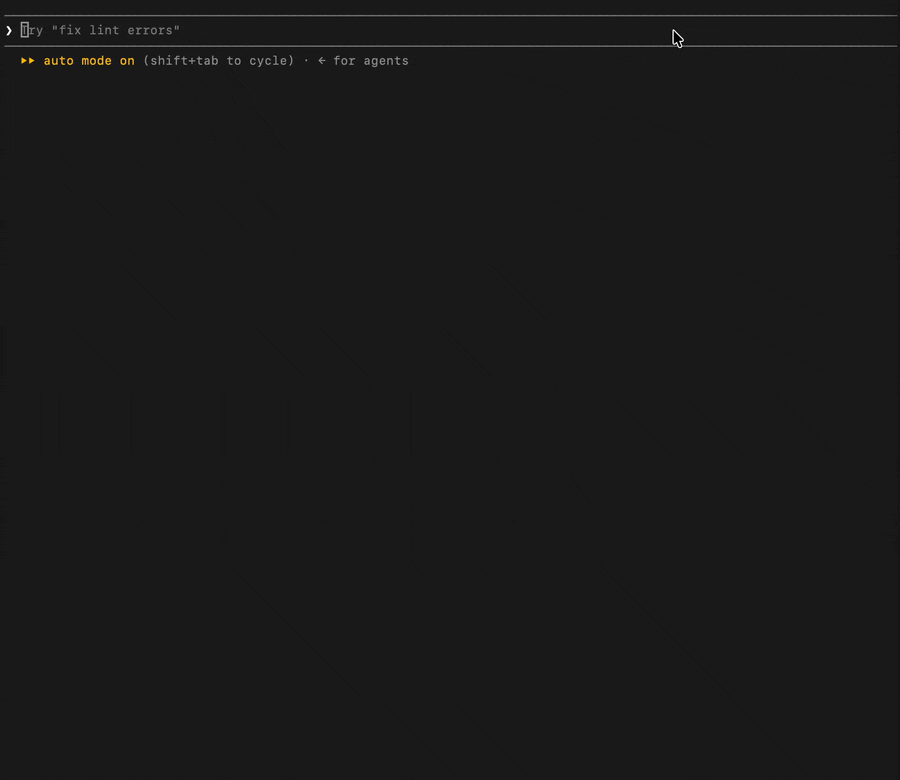

# sysmon-mcp


A read-only MCP server that lets Claude inspect your machine's memory, processes, disks and listening ports. Built with FastMCP and psutil.

## Install

Requires Python 3.10+.
```bash
git clone https://github.com/s4mt4r3/System-Monitor-MCP.git sysmon-mcp && cd sysmon-mcp
python3 -m venv .venv && source .venv/bin/activate
pip install -e .
```

**Claude Code** (run from the repo root):
```bash
claude mcp add --scope user sysmon -- "$(pwd)/.venv/bin/sysmon-mcp"
```

**Claude Desktop:** add this to `~/Library/Application Support/Claude/claude_desktop_config.json` (merge with any existing keys), then quit and reopen Claude Desktop:
```json
{
  "mcpServers": {
    "sysmon": { "command": "/absolute/path/to/sysmon-mcp/.venv/bin/sysmon-mcp" }
  }
}
```
## Tools

| Tool | Parameters | Returns |
|---|---|---|
| `memory_summary` | none | RAM and swap: total, available, used, free (bytes), percent |
| `top_processes` | `sort_by`: `"cpu"` or `"memory"` (default `"memory"`); `limit`: 1–50 (default 10) | pid, name, cpu_percent, memory_mb, username |
| `disk_usage` | none | Per partition: total, used, free (GiB), percent; unreadable partitions listed under `skipped` |
| `open_ports` | `limit`: 1–50 (default 20) | Listening TCP and bound UDP sockets: port, protocol, address, pid, process_name |

Out-of-range limits are clamped instead of rejected. Errors come back as `{"error": {"type", "message"}}` instead of crashing the server. Fields the OS won't reveal without root are `null`. On macOS, `open_ports` needs root and otherwise returns an `AccessDenied` error explaining why.

## Example prompts
Real output from a MacBook; the username is redacted to `user`, and `…` marks trimmed output.
**"Is my Mac under memory pressure? Show me RAM and swap, then the 5 processes using the most CPU right now."**
```json
{"memory":{"total":8589934592,"available":2355953664,"used":3892789248,"free":71843840,"percent":72.6},"swap":{"total":4294967296,"used":2840920064,"free":1454047232,"percent":66.1}}
{"pid":6098,"name":"python3.12","cpu_percent":8.2,"memory_mb":57.6,"username":"user"}
{"pid":1445,"name":"Code Helper (Renderer)","cpu_percent":6.2,"memory_mb":249.3,"username":"user"}
{"pid":5713,"name":"zoom.us","cpu_percent":3.4,"memory_mb":46.5,"username":"user"}
{"pid":14326,"name":"Code Helper","cpu_percent":2.8,"memory_mb":51.4,"username":"user"}
{"pid":4488,"name":"knowledge-agent","cpu_percent":1.2,"memory_mb":14.2,"username":"user"}
```
**"List the top 100 processes by memory."** (clamped to 50)
```json
{"sort_by":"memory","limit":50,"process_count":491,"truncated":true,"access_denied_count":185,"processes":[
{"pid":6036,"name":"Google Chrome Helper (Renderer)","cpu_percent":0.0,"memory_mb":340.8,"username":"user"}, …]}
```
**"How much free disk space do I have, and which volume is fullest?"**
```json
{"mountpoint":"/","device":"/dev/disk3s1s1","fstype":"apfs","total_gb":228.27,"used_gb":11.71,"free_gb":15.67,"percent":42.8}
{"mountpoint":"/System/Volumes/Data","device":"/dev/disk3s5","fstype":"apfs","total_gb":228.27,"used_gb":184.2,"free_gb":15.67,"percent":92.2}
```
**"What ports are listening on this machine, and which programs own them?"**
```json
{"error":{"type":"AccessDenied","message":"The OS denied access to the system-wide socket table. On macOS this requires root privileges, so it fails when the server runs as a normal user. This server is read-only and does not try to elevate privileges."}}
```
## Read-only by design

The server can observe the system but never change it. No tool kills or signals processes, runs commands or writes files. `tests/test_safety.py` checks the source on every test run:
- **Import allowlist:** `src/` may import only `asyncio`, `socket`, `typing`, `psutil` and `mcp`. Importing `os`, `subprocess`, `shutil`, `pathlib` or anything else fails the tests until someone deliberately adds it to the allowlist.
- **Banned names:** `open`, `eval`, `exec`, `getattr` and `__import__`, plus psutil's `Popen` and every mutating `Process` method (`kill`, `terminate`, `suspend`, `send_signal`, `nice` and others).
- **Grep guard:** fails if `subprocess`, `os.system`, `kill` or `terminate` appears anywhere in the source, including comments.
- **Tested checks:** 12 known bypasses, such as `getattr(p, "ki" + "ll")()` and `psutil.Popen([...])`, are run against them to prove they're caught.

Static checks can't prove Python safe, so treat this as a strong guardrail, not a sandbox.

## Running tests
```bash
pip install -e ".[dev]"
pytest -q
```
Every psutil call is mocked, so the results are the same on any machine.
